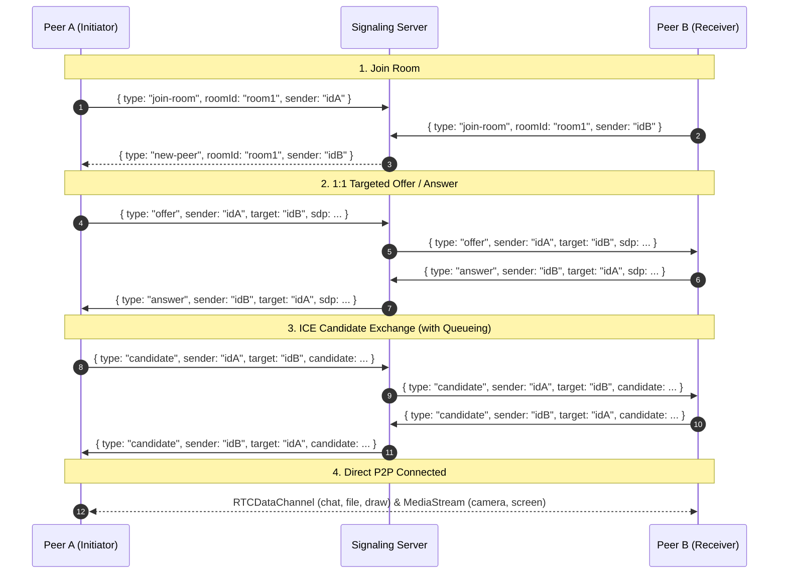
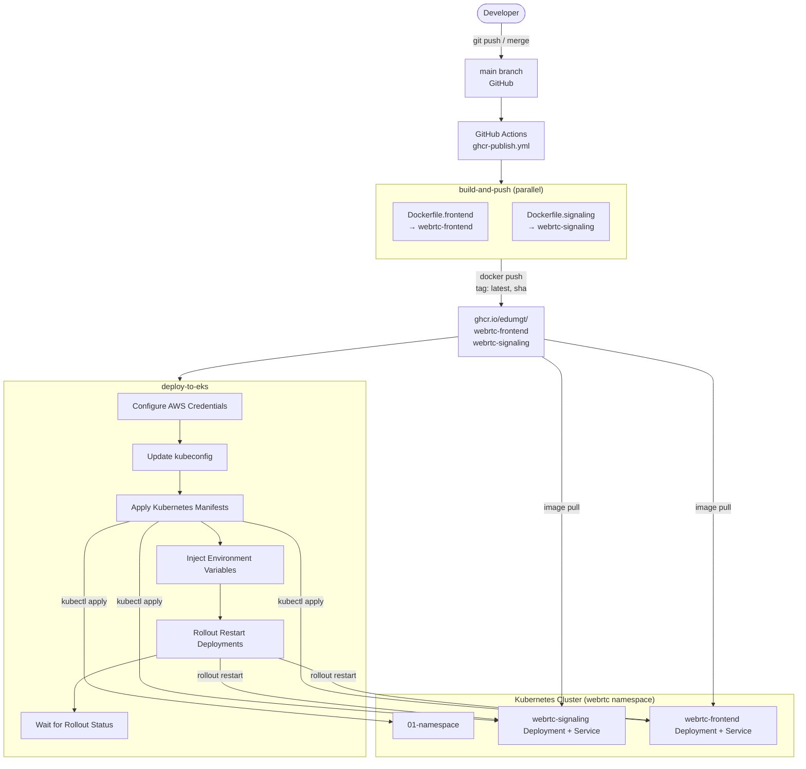

# Docker Advanced WebRTC Vue

A collaborative WebRTC studio web application built with **Vue 3** and **Node.js**.  
The frontend and signaling servers run as independent containerized microservices, fully orchestrated via Docker Compose for local development and ready for Amazon EKS / k3s Kubernetes deployments.

[한국어 문서 (readme-kr.md)](./readme-kr.md)

---

## Technical Stack & Architecture

### Frontend

| Category | Technology | Version | Description & Role |
|----------|------------|---------|---------------------|
| UI Framework | **Vue 3** | ^3.5 | Reactive component tree based on Composition API (`<script setup>`) |
| Build Tool | **Vite** | ^7.1 | Fast ESM bundling, HMR, and build-time env handling |
| Styling | **Tailwind CSS** | ^3.4 | Utility-first CSS styling and custom theme variables |
| Post-processing | **PostCSS** + autoprefixer | - | Vendor prefixing and CSS transformation |
| Charts & Metrics | **ApexCharts** (vue3-apexcharts) | ^5.3 | Operations dashboard: Donut, Timeseries, and Radar score charts |
| Runtime Web Server | **Node.js HTTP** (`frontend-server.cjs`) | 20.x | Static file server with runtime dynamic `env-config.js` injection |

#### Runtime Configuration Injection
- `VITE_SIGNAL_URL` is injected at **container runtime**, not hardcoded at build time.  
  When the container starts, `frontend-server.cjs` exposes `window.__APP_CONFIG__` via `/env-config.js`. This allows changing the signaling endpoint across different environments (local, staging, prod) without rebuilding the Docker image.
- `src/utils/signalUrl.js` resolves the WebSocket URL in the following precedence:
  1. Manual user override
  2. Runtime environment (`window.__APP_CONFIG__.VITE_SIGNAL_URL`)
  3. Build-time environment (`import.meta.env.VITE_SIGNAL_URL`)
  4. Auto-fallback: `${protocol}://${window.location.hostname}:${port}`

---

### Signaling Server

| Category | Technology | Version | Description & Role |
|----------|------------|---------|---------------------|
| Runtime | **Node.js** | 20.x (Alpine) | Lightweight CommonJS server (`server.cjs`) |
| WebSocket Library | **ws** | ^8.19 | RFC 6455 compliant WebSocket implementation |
| Protocol / Routing | HTTP + WebSocket (Unified Port) | - | Native `/health` probe endpoint + WebSocket upgrade handler |

#### Signaling Flow & P2P Mesh Topology
1. **Room Join**: Client sends `{ type: "join-room", roomId, sender }`. The server registers the socket with its `clientId` and notifies existing peers with `{ type: "new-peer", roomId, sender }`.
2. **1:1 Targeted Unicast Signaling**:
   - To prevent SDP Glare and state collisions in multi-user mesh networks, all subsequent signaling messages (`offer`, `answer`, `candidate`) must include `target: remoteId`.
   - The signaling server inspects `msg.target` and routes messages directly to the designated peer rather than blind broadcasting.
3. **Graceful Disconnection**: When a socket disconnects, the server broadcasts `{ type: "peer-left", roomId, sender }` to the room so remote peers can cleanly release connections and media tracks.

---

### WebRTC (Browser Native)

| Feature / API | Role & Implementation Details |
|---------------|-------------------------------|
| `RTCPeerConnection` | P2P audio, video, and data channel transport |
| **STUN Integration** | Configured with Google public STUN servers (`stun:stun.l.google.com:19302`, `stun1`, `stun2`) for reliable NAT/firewall traversal |
| **Candidate Queuing** | Buffers incoming remote ICE candidates until `setRemoteDescription` succeeds, preventing `InvalidStateError` race conditions |
| `RTCDataChannel` | Dedicated channels: `chat` (text), `file` (peer-to-peer file transfer), and `draw` (canvas sync) |
| `getUserMedia` | Local webcam and microphone capture |
| `getDisplayMedia` | Full PC desktop / application window screen sharing |
| `MediaStream` | Dynamic local/remote track binding and rendering |

---

### DevOps & Infrastructure

| Category | Technology | Description |
|----------|------------|-------------|
| Containerization | **Docker** + Docker Compose | Local multi-service orchestration |
| Base Image | `node:20-alpine` | Minimal production footprint |
| Multi-stage Build | `Dockerfile.frontend` | Strips dev tools/dependencies; serves only minified assets |
| Container Registry | **GitHub Container Registry (GHCR)** | `ghcr.io/edumgt/webrtc-frontend`, `ghcr.io/edumgt/webrtc-signaling` |
| Orchestration | **Kubernetes** (Amazon EKS / k3s) | Deployed in `webrtc` namespace with Deployments and Services |
| Automation Script | Shell (`provision-ec2-k8s-deploy.sh`) | Automated AWS EC2 + k3s cluster setup and pod deployment |
| CI/CD | **GitHub Actions** | Automated build, container push, and rollout |

---

## Project Structure

```
webrtc-app/
├── signaling/                   # Signaling server microservice
│   ├── server.cjs               # Production HTTP health + WebSocket signaling
│   ├── signal.js                # Minimal WebSocket broadcast script
│   └── package.json             # Dependencies: ws
│
├── frontend/                    # Vue 3 SPA + runtime file server
│   ├── src/
│   │   ├── App.vue              # Main application shell with dual offcanvas layout
│   │   ├── composables/
│   │   │   └── useWebRTC.js     # WebRTC state, targeted signaling, and event management
│   │   ├── components/
│   │   │   ├── Whiteboard.vue   # Real-time collaborative canvas
│   │   │   ├── ChatBox.vue      # P2P text chat
│   │   │   ├── FileBox.vue      # P2P file transfer
│   │   │   ├── MediaPanel.vue   # Camera and screen share grid
│   │   │   ├── SystemPanel.vue  # CloudWatch metrics & system dashboard
│   │   │   └── Video.vue        # Legacy standalone video component
│   │   └── utils/
│   │       └── signalUrl.js     # WebSocket URL resolution helper
│   ├── index.html
│   ├── vite.config.js
│   ├── tailwind.config.js
│   ├── postcss.config.js
│   ├── frontend-server.cjs      # Node runtime server (dynamic /env-config.js)
│   └── package.json
│
├── Dockerfile.signaling         # Alpine single-stage image
├── Dockerfile.frontend          # Alpine multi-stage build (build + serve)
├── docker-compose.yml           # Local multi-container setup (ports 8480 / 8481)
├── .env                         # Local environment variables
├── .env.example                 # Environment template
├── scripts/
│   └── provision-ec2-k8s-deploy.sh  # EC2 + k3s automated deployment script
├── kube-manifests/              # Kubernetes manifests
└── .github/workflows/           # CI/CD workflows
```

---

## Getting Started (Docker Compose)

### 1. Run with Docker Compose

```bash
# Build images and start containers
docker compose up --build

# Or run in detached mode
docker compose up --build -d
```

| Service | Address |
|---------|---------|
| Frontend | [http://localhost:8480](http://localhost:8480) |
| Signaling Server | `ws://localhost:8481` |

> Ports `8480` and `8481` are selected to avoid collisions with default development ports (80, 3000, 8080).

### 2. Environment Configuration

Create or modify `.env` in the root directory:

```env
# Signaling server host port accessed by client browsers
VITE_SIGNAL_URL=
VITE_SIGNAL_PORT=8481

# Frontend container internal port
FRONTEND_HOST=0.0.0.0
FRONTEND_PORT=80

# Signaling container internal port
SIGNAL_HOST=0.0.0.0
SIGNAL_PORT=3001
```

For AWS / Production deployments, specify the load balancer address:
```env
VITE_SIGNAL_URL=wss://your-load-balancer-url.amazonaws.com
```

---

## Local Development (Without Docker)

### 1. Signaling Server
```bash
cd signaling
npm install
npm start            # Runs server.cjs on port 3001 (with /health and room routing)
```

### 2. Frontend
```bash
cd frontend
npm install
npm run dev          # Vite development server (port 5173)

# For WSL2 external access:
npm run dev:wsl
```

---

## Signaling & P2P Sequence Diagram



---

## CI/CD Workflow (GitHub Actions & EKS)



---

## AWS EC2 + k3s Automated Deployment

The script [`scripts/provision-ec2-k8s-deploy.sh`](./scripts/provision-ec2-k8s-deploy.sh) automates end-to-end cloud infrastructure setup:

1. Creates or verifies Amazon ECR repositories (`webrtc-frontend`, `webrtc-signaling`).
2. Builds and pushes multi-architecture Docker images to ECR.
3. Launches an EC2 instance with specified subnet, key pair, and security groups.
4. Automatically installs **k3s** (lightweight Kubernetes) on the EC2 host via SSH.
5. Generates ECR pull secrets and deploys NodePort services (`30080` for frontend, `30081` for signaling).

Required environment variables:
```bash
export AWS_REGION=ap-northeast-2
export EC2_AMI_ID=ami-xxxxxxxxxxxxxxxxx
export EC2_KEY_NAME=my-keypair
export EC2_SECURITY_GROUP_ID=sg-xxxxxxxxxxxxxxxxx
export EC2_SUBNET_ID=subnet-xxxxxxxxxxxxxxxxx
export SSH_PRIVATE_KEY_PATH=/path/to/keypair.pem
```

Execution:
```bash
chmod +x ./scripts/provision-ec2-k8s-deploy.sh
./scripts/provision-ec2-k8s-deploy.sh
```

---

## Key Files Reference

| File | Purpose |
|------|---------|
| [`frontend/src/App.vue`](./frontend/src/App.vue) | Main shell layout and offcanvas navigation |
| [`frontend/src/composables/useWebRTC.js`](./frontend/src/composables/useWebRTC.js) | WebRTC state, STUN configuration, and 1:1 signaling logic |
| [`frontend/src/components/Whiteboard.vue`](./frontend/src/components/Whiteboard.vue) | Shared canvas drawing component |
| [`frontend/src/components/MediaPanel.vue`](./frontend/src/components/MediaPanel.vue) | Video grid for webcam and screen share streams |
| [`frontend/src/components/ChatBox.vue`](./frontend/src/components/ChatBox.vue) | P2P text messaging component |
| [`frontend/src/components/FileBox.vue`](./frontend/src/components/FileBox.vue) | P2P file drop and transfer interface |
| [`frontend/src/components/SystemPanel.vue`](./frontend/src/components/SystemPanel.vue) | Operational dashboard with ApexCharts metrics |
| [`frontend/frontend-server.cjs`](./frontend/frontend-server.cjs) | Static file server with dynamic runtime env injection |
| [`signaling/server.cjs`](./signaling/server.cjs) | WebSocket signaling server with targeted unicast routing |
| [`Dockerfile.frontend`](./Dockerfile.frontend) | Multi-stage build for frontend production image |
| [`Dockerfile.signaling`](./Dockerfile.signaling) | Lightweight Alpine signaling image |
| [`docker-compose.yml`](./docker-compose.yml) | Local multi-service orchestrator |

---

## License & Ownership

(주)에듀엠지티 · [www.edumgt.co.kr](https://www.edumgt.co.kr)
