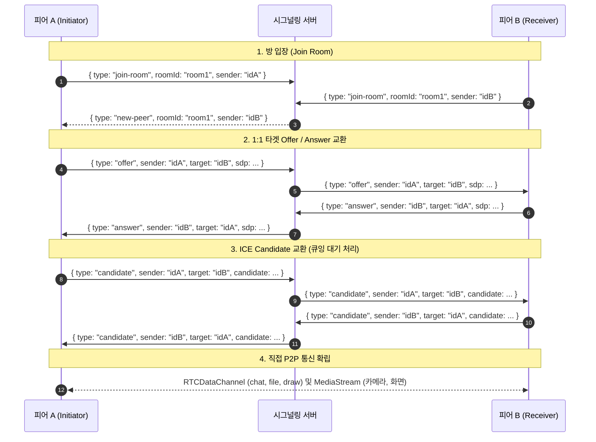
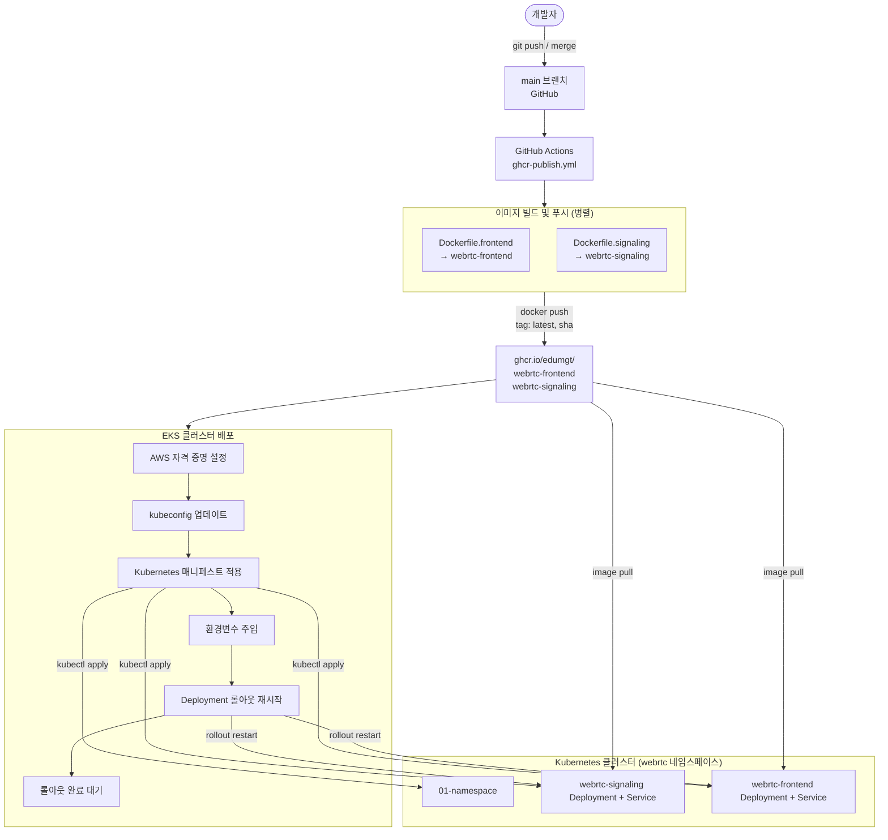

# Docker Advanced WebRTC Vue

Vue 3와 Node.js 기반의 협업형 실시간 WebRTC 웹 애플리케이션입니다.  
프런트엔드와 시그널링 서버가 각각 독립된 컨테이너로 동작하며, Docker Compose를 통해 로컬에서 즉시 실행하거나 Amazon EKS / k3s Kubernetes 환경에 배포할 수 있습니다.

[English Documentation (Readme.md)](./Readme.md)

---

## 기술 스택 및 아키텍처

### Frontend

| 분류 | 기술 | 버전 | 역할 및 설명 |
|------|------|------|-------------|
| UI Framework | **Vue 3** | ^3.5 | Composition API (`<script setup>`) 기반 반응형 컴포넌트 트리 |
| Build Tool | **Vite** | ^7.1 | 고속 ESM 번들링, HMR, 빌드 타임 환경변수 처리 |
| Styling | **Tailwind CSS** | ^3.4 | 유틸리티 클래스 기반 스타일링 및 커스텀 테마 변수 |
| CSS Post-processing | **PostCSS** + autoprefixer | - | CSS 변환 및 벤더 접두사 자동 처리 |
| Chart Library | **ApexCharts** (vue3-apexcharts) | ^5.3 | 운영 대시보드: 도넛·시계열·레이더 스코어 차트 |
| Runtime Server | **Node.js HTTP** (`frontend-server.cjs`) | 20.x | `dist/` 정적 파일 서빙 + `/env-config.js` 런타임 환경변수 동적 주입 |

#### 런타임 환경변수 주입 (Runtime Configuration)
- `VITE_SIGNAL_URL`은 빌드 타임에 고정되지 않고 **컨테이너 실행 시점(런타임)**에 주입됩니다.  
  `frontend-server.cjs`가 컨테이너 시작 시 `window.__APP_CONFIG__`를 `/env-config.js` 엔드포인트로 노출하므로, 도커 이미지를 재빌드하지 않고 환경변수 변경만으로 시그널링 주소를 유연하게 변경할 수 있습니다.
- `src/utils/signalUrl.js`는 다음 우선순위에 따라 WebSocket 주소를 결정합니다:
  1. 사용자 수동 입력 주소
  2. 런타임 환경변수 (`window.__APP_CONFIG__.VITE_SIGNAL_URL`)
  3. 빌드타임 환경변수 (`import.meta.env.VITE_SIGNAL_URL`)
  4. 자동 폴백: `${protocol}://${window.location.hostname}:${port}`

---

### Signaling Server

| 분류 | 기술 | 버전 | 역할 및 설명 |
|------|------|------|-------------|
| Runtime | **Node.js** | 20.x (Alpine) | 경량 CommonJS 단일 파일 서버 (`server.cjs`) |
| WebSocket | **ws** | ^8.19 | RFC 6455 표준 WebSocket 서버 구현 |
| Protocol | HTTP + WebSocket (단일 포트) | - | `/health` 헬스체크 프로브 + WebSocket upgrade 동시 처리 |

#### 시그널링 흐름 및 P2P Mesh 라우팅
1. **방 입장 (`join-room`)**: 클라이언트가 `{ type: "join-room", roomId, sender }`를 전송하면 서버가 소켓에 `clientId`를 매핑하고, 기존 피어들에게 `{ type: "new-peer", roomId, sender }`를 브로드캐스트합니다.
2. **1:1 타겟 유니캐스트 시그널링 (`Targeted Unicast`)**:
   - 다자간(3인 이상) Mesh 환경에서 SDP Glare(교차 충돌) 및 상태 꼬임을 방지하기 위해 `offer`, `answer`, `candidate` 메시지는 반드시 `target: remoteId`를 포함합니다.
   - 시그널링 서버는 `target` 필드를 식별하여 무차별 브로드캐스트가 아닌 지정된 상대방에게만 1:1로 메시지를 전달합니다.
3. **안전한 피어 종료 (`peer-left`)**: 소켓 연결이 끊어지면 서버가 방 내 피어들에게 `{ type: "peer-left", roomId, sender }`를 전송하여 원격 피어들이 미디어 트랙 및 데이터 채널을 누수 없이 즉시 해제하도록 합니다.

---

### WebRTC (브라우저 네이티브)

| API / 기능 | 역할 및 구현 상세 |
|-----------|------------------|
| `RTCPeerConnection` | P2P 오디오, 비디오 및 데이터 채널 전송 |
| **STUN 서버 통합** | Google 공용 STUN 서버(`stun:stun.l.google.com:19302`, `stun1`, `stun2`)를 기본 등록하여 NAT/공유기 및 방화벽 환경에서도 P2P 세션 정상 수립 |
| **ICE Candidate 큐잉** | 원격 SDP(`setRemoteDescription`)가 완료되기 전에 도착한 Candidate를 대기열에 보관 후 순차 적용하여 `InvalidStateError` 방지 |
| `RTCDataChannel` | 3개 전용 채널 분리 운영: `chat` (채팅), `file` (P2P 파일 전송), `draw` (캔버스 좌표 동기화) |
| `getUserMedia` | 로컬 웹캠 및 마이크 캡처 |
| `getDisplayMedia` | 화면 공유 캡처 (화면 공유 종료 감지 이벤트 처리 포함) |
| `MediaStream` | 동적 로컬/원격 트랙 바인딩 및 실시간 렌더링 |

---

### DevOps / Infra

| 분류 | 기술 | 역할 |
|------|------|------|
| 컨테이너 | **Docker** + Docker Compose | 로컬 멀티 컨테이너 오케스트레이션 |
| 베이스 이미지 | `node:20-alpine` | 경량 프로덕션 이미지 |
| 멀티스테이지 빌드 | `Dockerfile.frontend` | 빌드 의존성을 최종 런타임 이미지에서 완전히 제거 |
| 컨테이너 레지스트리 | **GitHub Container Registry (GHCR)** | `ghcr.io/edumgt/webrtc-frontend`, `ghcr.io/edumgt/webrtc-signaling` |
| 오케스트레이션 | **Kubernetes** (Amazon EKS / k3s) | `webrtc` 네임스페이스 내 Deployment 및 Service 운영 |
| 프로비저닝 스크립트 | Bash (`provision-ec2-k8s-deploy.sh`) | AWS EC2 생성 + k3s 설치 + ECR 연동 자동화 |
| CI/CD | **GitHub Actions** | 코드 푸시 시 빌드, 이미지 푸시, 롤아웃 자동화 |

---

## 프로젝트 구조

```
webrtc-app/
├── signaling/                   # 시그널링 서버
│   ├── server.cjs               # 프로덕션 HTTP 헬스체크 + WebSocket 시그널링
│   ├── signal.js                # 단순 브로드캐스트 스크립트
│   └── package.json             # 의존성: ws
│
├── frontend/                    # Vue 3 앱 + 정적 서버
│   ├── src/
│   │   ├── App.vue              # 루트 컴포넌트 (좌우 offcanvas 레이아웃)
│   │   ├── composables/
│   │   │   └── useWebRTC.js     # WebRTC 상태, STUN 및 1:1 타겟 시그널링 관리
│   │   ├── components/
│   │   │   ├── Whiteboard.vue   # 실시간 공유 드로잉 캔버스
│   │   │   ├── ChatBox.vue      # 실시간 P2P 채팅
│   │   │   ├── FileBox.vue      # P2P 파일 전송 드롭존
│   │   │   ├── MediaPanel.vue   # 카메라 및 화면 공유 그리드
│   │   │   ├── SystemPanel.vue  # CloudWatch 지표 및 시스템 대시보드
│   │   │   └── Video.vue        # 레거시 단일 비디오 컴포넌트
│   │   └── utils/
│   │       └── signalUrl.js     # WebSocket URL 결정 유틸
│   ├── index.html
│   ├── vite.config.js
│   ├── tailwind.config.js
│   ├── postcss.config.js
│   ├── frontend-server.cjs      # 정적 서빙 + 런타임 env 주입 서버
│   └── package.json
│
├── Dockerfile.signaling         # 시그널링용 Alpine 이미지
├── Dockerfile.frontend          # 프론트엔드 멀티스테이지 빌드 이미지
├── docker-compose.yml           # 로컬 멀티 컨테이너 실행 구성 (포트 8480 / 8481)
├── .env                         # 로컬 환경변수 설정 파일
├── .env.example                 # 환경변수 템플릿 예시
├── hermes/                      # Hermes 가상 조직 (backlog, config, workspace)
├── AGENTS.md                    # 에이전트 헌장
├── scripts/
│   └── provision-ec2-k8s-deploy.sh  # EC2 + k3s 자동 배포 스크립트
├── kube-manifests/              # Kubernetes 매니페스트
└── .github/workflows/           # GitHub Actions 워크플로
```

---

## 로컬 Docker 실행 방법

### 1. Docker Compose 실행

```bash
# 이미지 빌드 후 컨테이너 실행
docker compose up --build

# 백그라운드(데몬) 실행
docker compose up --build -d
```

| 서비스 | 접속 주소 |
|--------|----------|
| 프런트엔드 | [http://localhost:8480](http://localhost:8480) |
| 시그널링 서버 | `ws://localhost:8481` |

> 포트 `8480` / `8481`은 일반적인 포트(80, 3000, 8080)와의 충돌을 피하기 위해 설정되어 있습니다.

### 2. 환경변수 설정

루트 디렉토리의 `.env` 파일에서 포트 및 설정을 지정할 수 있습니다:

```env
# 브라우저가 접속하는 시그널링 호스트 포트 (docker-compose 매핑 포트와 일치)
VITE_SIGNAL_URL=
VITE_SIGNAL_PORT=8481

# 프런트엔드 컨테이너 내부 포트
FRONTEND_HOST=0.0.0.0
FRONTEND_PORT=80

# 시그널링 컨테이너 내부 포트
SIGNAL_HOST=0.0.0.0
SIGNAL_PORT=3001
```

AWS 및 운영 환경 배포 시 `VITE_SIGNAL_URL`에 로드밸런서 주소를 입력합니다:
```env
VITE_SIGNAL_URL=wss://your-load-balancer-url.amazonaws.com
```

---

## 로컬 개발 환경 (Docker 없이 실행)

### 1. 시그널링 서버 실행
```bash
cd signaling
npm install
npm start            # server.cjs 실행 (3001 포트, /health 및 1:1 라우팅 지원)
```

### 2. 프런트엔드 실행
```bash
cd frontend
npm install
npm run dev          # Vite 개발 서버 실행 (5173 포트)

# WSL2 외부 호스트 접속 허용 실행 시:
npm run dev:wsl
```

---

## 시그널링 및 P2P 시퀀스 다이어그램



---

## CI/CD 빌드 및 배포 흐름



---

## AWS EC2 + k3s 자동 배포 스크립트

[`scripts/provision-ec2-k8s-deploy.sh`](./scripts/provision-ec2-k8s-deploy.sh) 스크립트를 사용하여 클라우드 인프라 프로비저닝을 자동으로 수행할 수 있습니다:

1. Amazon ECR 리포지토리(`webrtc-frontend`, `webrtc-signaling`) 생성 확인
2. Docker 이미지를 빌드하여 ECR에 푸시
3. 지정된 서브넷/보안그룹 기반 EC2 인스턴스 생성
4. SSH를 통해 EC2 내에 **k3s**(경량 Kubernetes) 자동 설치
5. ECR 인증 시크릿을 생성하고 NodePort 서비스(`30080`: 프론트엔드, `30081`: 시그널링) 배포

필수 환경변수:
```bash
export AWS_REGION=ap-northeast-2
export EC2_AMI_ID=ami-xxxxxxxxxxxxxxxxx
export EC2_KEY_NAME=my-keypair
export EC2_SECURITY_GROUP_ID=sg-xxxxxxxxxxxxxxxxx
export EC2_SUBNET_ID=subnet-xxxxxxxxxxxxxxxxx
export SSH_PRIVATE_KEY_PATH=/path/to/keypair.pem
```

실행:
```bash
chmod +x ./scripts/provision-ec2-k8s-deploy.sh
./scripts/provision-ec2-k8s-deploy.sh
```

---

## 주요 파일 안내

| 파일 | 설명 |
|------|------|
| [`frontend/src/App.vue`](./frontend/src/App.vue) | 루트 컴포넌트, 좌우 offcanvas 레이아웃 |
| [`frontend/src/composables/useWebRTC.js`](./frontend/src/composables/useWebRTC.js) | WebRTC 전체 상태, STUN 설정, 1:1 타겟 시그널링 관리 |
| [`frontend/src/components/Whiteboard.vue`](./frontend/src/components/Whiteboard.vue) | 실시간 공유 드로잉 캔버스 |
| [`frontend/src/components/MediaPanel.vue`](./frontend/src/components/MediaPanel.vue) | 웹캠 및 화면 공유 비디오 그리드 |
| [`frontend/src/components/ChatBox.vue`](./frontend/src/components/ChatBox.vue) | P2P 텍스트 채팅 컴포넌트 |
| [`frontend/src/components/FileBox.vue`](./frontend/src/components/FileBox.vue) | P2P 파일 드래그 앤 드롭 전송 UI |
| [`frontend/src/components/SystemPanel.vue`](./frontend/src/components/SystemPanel.vue) | 운영 대시보드 (ApexCharts) |
| [`frontend/frontend-server.cjs`](./frontend/frontend-server.cjs) | 런타임 환경변수 동적 주입 정적 서버 |
| [`signaling/server.cjs`](./signaling/server.cjs) | 1:1 유니캐스트 라우팅 WebSocket 시그널링 서버 |
| [`Dockerfile.frontend`](./Dockerfile.frontend) | 멀티스테이지 프런트엔드 프로덕션 이미지 |
| [`Dockerfile.signaling`](./Dockerfile.signaling) | 경량 Alpine 시그널링 이미지 |
| [`docker-compose.yml`](./docker-compose.yml) | 로컬 멀티 서비스 오케스트레이션 |

---

## Hermes 가상 조직 (AI 에이전트 고도화 파이프라인)

이 저장소는 [todo.md](./todo.md)의 설계대로 **Hermes 모델 기반 가상 소프트웨어 조직(PM → 디자이너 → 개발자 ⇄ QA)**이
`hermes/backlog/`의 티켓을 받아 코드를 고도화하도록 구성되어 있습니다.

```bash
ollama pull hermes3:8b
cd hermes && cp .env.example .env && uv sync --extra dev
uv run hermes check          # 엔드포인트·설정·백로그 점검
uv run hermes backlog        # 티켓 목록
uv run hermes run HX-002     # 티켓 실행 → hermes/HX-002 브랜치 + workspace 산출물
uv run hermes daemon        # 자율 모드: 백로그 순회·브랜치 커밋·새 티켓 제안 (승인·머지는 사람)
uv run hermes status        # 승인 대기 / 리뷰 대기 / 막힘 확인
```

- 조직 정의: [hermes/config/org.yaml](./hermes/config/org.yaml) · 운영 가이드: [hermes/README.md](./hermes/README.md) · 에이전트 헌장: [AGENTS.md](./AGENTS.md)
- 테스트: `signaling` → `npm test` (node --test), `frontend` → `npm test` (vitest) · CI: `.github/workflows/ci.yml`
- GitHub에서 실행: `Hermes ticket run` 워크플로(workflow_dispatch)에 티켓 ID 입력 → PR 자동 생성

---

## 라이선스 및 소유권

(주)에듀엠지티 · [www.edumgt.co.kr](https://www.edumgt.co.kr)
